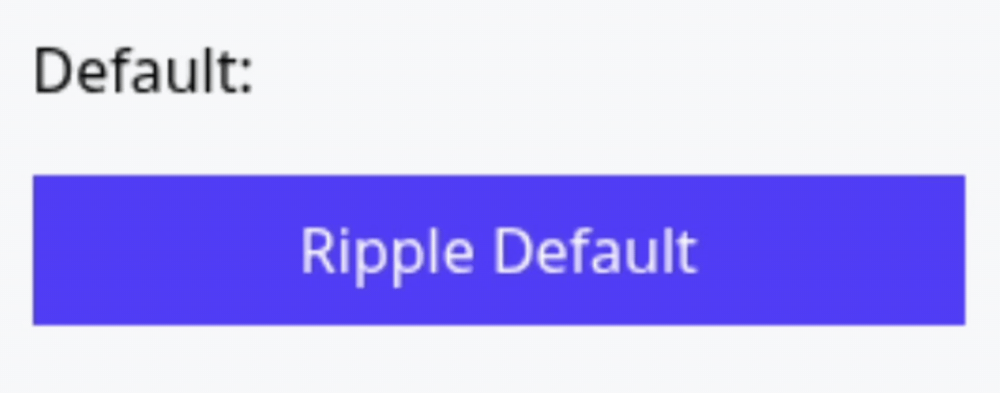

# alpinejs-ripple


A simple yet powerful alpinejs directive to add ripple effects to any element using the `::before` or `::after` css selectors. No new elements are added to the DOM making this very stable. Simply use the directive `x-ripple` on any HTML element.

The package is minimal and simple. We are using the following css classes so make sure you are not overwriting them by accident:

- `.ripple`
- `.ripple-before`
- `.ripple-after`
- `.ripple--active`

This package has been developed for [bellisUI](https://bellis-ui.com/docs/ripple) but it can be used standalone as it is just an alpinejs plugin.

## Install

### With a CDN

```html
<script defer src="https://unpkg.com/alpinejs-ripple@latest/dist/ripple.min.js"></script>
<link rel="stylesheet" href="https://unpkg.com/alpinejs-ripple@latest/dist/ripple.css">

<script defer src="https://unpkg.com/alpinejs@3.x.x/dist/cdn.min.js"></script>
```

### With a Package Manager

Choose whatever package manager you use. 

```shell
npm install alpinejs-ripple

yarn add alpinejs-ripple

pnpm add alpinejs-ripple
```

Then load the Alpine plugin in your main javascript file.

```js
import Alpine from 'alpinejs'
import Ripple from 'alpinejs-ripple'

Alpine.plugin(Ripple)

Alpine.start()
```

## Examples

You can find a full example in the [index.html](./index.html) file.

<p align="center">
    
</p>

### Default usage

We are using sensible defaults that look good out of the box.

```html
<button x-ripple></button>
```

### Custom duration

You can customize the duration in seconds or milliseconds.

```html
<button x-ripple.duration.2s>2 Seconds</button>
<button x-ripple.duration.1_5s>1.5 Seconds</button>
<button x-ripple.duration.250ms>250 Milliseconds</button>
```

### Custom radius

You can customize the border radius in px, rem or %.

```html
<button x-ripple.radius.0px>0 Pixel</button>
<button x-ripple.radius.3rem>3 Rem</button>
<button x-ripple.radius.25%>25 Percent</button>
```

### Custom color

You can customize the color with builtin colors, hex or variables.

```html
<button x-ripple.color.red>Builtin color</button>
<button x-ripple.color.#f00>Short hex</button>
<button x-ripple.color.#ff0000>Long hex</button>
<button x-ripple.color.--some-color>Variable</button>
```

### Custom opacity

You can customize the opacity.

```html
<button x-ripple.opacity.0>Invisible</button>
<button x-ripple.opacity.0_5>50% Visible</button>
<button x-ripple.opacity.1>100% Visible</button>
```

### Custom animation timing

You can customize the animation timing function.

```html
    <button x-ripple.timing.ease>ease</button>
    <button x-ripple.timing.ease-in>ease-in</button>
    <button x-ripple.timing.ease-out>ease-out</button>
    <button x-ripple.timing.ease-in-out>ease-in-out</button>
    <button x-ripple.timing.linear>linear</button>
```

### Using ::before instead of ::after

By default the ripple is placed in the ::after pseudo-element. If that is already used by your element you can switch to ::before instead.

```html
    <button x-ripple.before>ease</button>
```


### Customizing via css variables

All modifiers can also be set via css by setting the respective variable. This allows you to set global defaults or regional ones.

Global default:
```css
* {
    --ripple-duration: 2s; 
    --ripple-radius: 100px; 
    --ripple-color: red;
    --ripple-timing: linear;
    --ripple-opacity: 1;
}
```

Regional default:
```html
<div style="
    --ripple-duration: 2s; --ripple-radius: 100px; --ripple-color: red; 
    --ripple-timing: linear; --ripple-opacity: 1;">
    ...
    <button x-ripple>Some buton</button>
    ...
</div>
```

Local:
```html
<button x-ripple style="
    --ripple-duration: 2s; --ripple-radius: 100px; --ripple-color: red; 
    --ripple-timing: linear; --ripple-opacity: 1;">
    Some buton
</button>
```

## Contributing

1. Clone the repository.
2. Run `npm install`.
3. Make whatever changes you want.
4. Run `npm run build` to build your changed files.
5. Either use the build files directly or use something like [vercel/serve](https://www.npmjs.com/package/serve) to locally test your changes.

## License

MIT